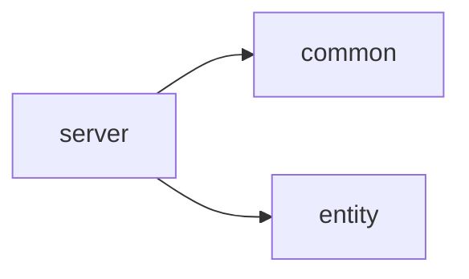

# 后端 Maven 依赖与模块规划

核查日期：2026-10-29（Asia/Shanghai）。适用项目：`D:/CodingFiles/Blog/DriftingLeavesV2`。

本文件保留 2026-10-29 的依赖规划及核查记录。2026-10-30 已落地身份与系统管理、19表实体（原18表加操作日志）、配置与测试，版本以四份POM为准。共享配置、平台客户端、Redis授权存储、会话和限流已下沉common；本次进一步按明确需求加入OSS客户端、注解/切面、IP/Markdown工具和虚拟线程，第4节及依赖落点随之更新。当前运行与验证以 [后端运行说明](后端运行说明.md) 为准，下面第9节早期无源码结果是历史记录。

2026-11-01 补充：[实时在线人数接口规划](实时在线人数接口规划.md)已在 server 加入由当前 Boot BOM 管理的 `spring-boot-starter-websocket`，仅使用原生文本消息与Spring会话发送保护；不升级框架、不引入STOMP/SockJS或消息代理。下文“省略 WebSocket/在线人数”保留为历史取舍，新需求以当前在线实现说明为准；不涉及 OSHI 或服务器监控。

## 1. 建议基线与结论

沿用老项目的三个模块职责，新模块目录及 artifactId 按用户指定为 **common、entity、server**（entity 对应老项目 DL-pojo）。继续采用 Spring MVC + MyBatis-Plus + MySQL；鉴权固定为 **Sa-Token + JustAuth**，会话及 OAuth state 使用 Redis。只部署一个后端应用，不拆微服务，不增加 auth/system/blog 等 Maven 模块。

| 项目 | 建议版本 | 选择依据及维护情况 |
| --- | --- | --- |
| JDK | **21 LTS**；安全更新目标为 Eclipse Temurin **21.0.13+9** | 延续老项目 Java 21；Boot 4.1.2 支持 Java 17–27。Temurin 21 仍在维护期；所查发布页各平台更新进度不同，Windows 下载区曾仍显示旧包，不能据此声称所有平台的 21.0.13 安装包均已就绪 |
| Maven | **3.10.0** | Apache 官方当前正式版，满足 Boot 要求的 Maven ≥3.6.3；不采用 Maven 4 RC |
| Spring Boot | **4.1.2** | 官方当前正式版本。旧项目 3.5.7 不直接继承：官方已宣布 3.5.16 为 3.5 系列最后一个 OSS 版本；新项目没有现存 Java 代码需要迁移，更适合直接使用仍维护的 4.x |
| Sa-Token | **1.46.0** | 官方已发布，提供 Boot 4 专用 starter；该版本包含 JSON 多态反序列化等安全修复，不回退到旧示例版本 |
| JustAuth | **1.16.7** | Maven Central 与官方 Release 均可核实；官方 Release 列表仍以此版为最新，不能推断其具备与 Spring 相同的持续维护或平台 API 更新保证 |
| MyBatis-Plus | **3.5.17**（全家族统一） | 本规划选择已核实完整坐标的稳定基线，使用 Boot 4 starter。检索时官方快速开始已展示 3.5.18，Central 部分页面又显示刚发布的 3.5.18.1；不混用不同缓存页面的版本。本方案不宣称 3.5.17 是最新版 |

依据：[Boot 4.1.2 系统要求](https://docs.spring.io/spring-boot/system-requirements.html)、[Boot 3.5 最后 OSS 发行声明](https://spring.io/blog/2026/06/25/spring-boot-3-5-16-available-now/)、[Maven 官方下载与维护说明](https://maven.apache.org/download.cgi)、[Temurin 支持周期](https://adoptium.net/support)、[Temurin 21 发布页](https://adoptium.net/temurin/releases?variant=openjdk21&version=21)、[Temurin 十月安全更新说明](https://adoptium.net/pt-BR/news/2026/10/temurin-october-2026-emudhra)、[Sa-Token 1.46.0 Release](https://github.com/dromara/Sa-Token/releases/tag/v1.46.0)、[JustAuth Releases](https://github.com/justauth/JustAuth/releases)。

这里的“兼容”分两层：官方明确提供 Boot 4/Jakarta 适配；**初次核查仅包含无源码打包；现已通过 Java 编译、身份隔离集成测试和可执行 jar 打包，真实 OAuth 平台仍需联调**。Sa-Token 的发布源码使用 Boot 4.0.3 依赖基线，MyBatis-Plus 3.5.17 的 Boot 4 starter 使用 Boot 4.0.1 基线；升级到本项目的 4.1.2 是依据同代框架适配作出的方案判断，不是两家厂商对该组合的专项测试声明。

## 2. 老项目只读核查结果

### 2.1 真实目录与父子 POM

检查根目录为 `D:/CodingFiles/Blog/DriftingLeaves-Website/Backend`。真实结构如下，`docs` 是资料目录，不是 Maven 子模块：

```text
Backend/
├── pom.xml                  com.xuan:DriftingLeaves:1.0-SNAPSHOT，packaging=pom
├── DL-pojo/pom.xml          parent=上述根 POM，默认 jar
├── DL-common/pom.xml        parent=上述根 POM，默认 jar
├── DL-server/pom.xml        parent=上述根 POM，默认 jar，可执行应用
└── docs/                    非 Maven 模块
```

根 POM 的 `<modules>` 顺序确实为 `DL-pojo`、`DL-common`、`DL-server`，上级 parent 为 `org.springframework.boot:spring-boot-starter-parent:3.5.7`。三个子 POM 均继承 `com.xuan:DriftingLeaves:1.0-SNAPSHOT`。

**现有内部依赖只有 `DL-server → DL-common` 和 `DL-server → DL-pojo`。** `DL-common` 没有声明对 `DL-pojo` 的依赖，`DL-pojo` 也没有声明对 `DL-common` 的依赖。不能按常见项目模板臆造 `common → pojo`，也不能把父 POM 继承误画为业务依赖。

### 2.2 声明、实际用途与新项目取舍

下表版本是老根 POM 的声明；没有执行 Maven effective-pom/dependency:tree，不能将所有属性都当成最终解析版本。

| 老项目声明 | 实际使用证据（相对老 Backend） | 新项目决定 |
| --- | --- | --- |
| Boot Web、Validation、Test | `DL-server/controller`、DTO 的 `jakarta.validation`、`DL-server/src/test` | 保留功能，升级为 Boot 4 对应 starter；Web 只放 server |
| MyBatis-Plus Boot 3 starter 3.5.7，在三个模块均声明 | pojo 实体表注解；common 的 `result/PageResult.java` 引用 `IPage`；server 的 Mapper、Service、`config/MybatisPlusConfig.java` 分页插件 | 按实际 API 依赖缩小：新 entity 用 annotation，common 用 core，server 用 Boot 4 starter + 独立分页依赖 |
| MySQL Connector/J 8.0.33、Druid 1.2.23 | server POM、数据源模板指定 `DruidDataSource` | Connector/J 跟随新 Boot BOM；连接池使用 JDBC starter 的 HikariCP，去掉 Druid |
| JJWT 0.12.5 三件套 | common `utils/JwtUtil.java`；server 的管理员拦截器、访客 Token、RSS 订阅等 | 本站登录改 Sa-Token Session；旧管理员/访客/RSS Token 体系不移植，不直接引入 JJWT |
| Redis、Spring Cache | `RedisConfiguration.java`；会话/验证码/计数/业务缓存及监控采集使用 Redis；多个 Service 使用缓存注解 | 保留 Redis 客户端，供 Sa-Token/state/限流；首期不复制业务缓存和计数同步体系 |
| Fastjson2 2.0.54，在三个模块声明 | pojo 的 `JSONField`，server 的日志/RSS JSON 处理；common 的 JSON 配置实际使用 Jackson | API JSON 统一 Boot 的 Jackson 3；不把旧 Fastjson 注解带入新 DTO。JustAuth 的内部兼容依赖单独处理 |
| Hutool-all 5.8.32 | 多个 server Service 的 BeanUtil、HTTP、随机值等；common POM 也声明 | 不继承整包；新代码优先 JDK/Spring。JustAuth HTTP 可用 JDK 客户端，无需为它加 Hutool |
| Aliyun OSS 3.17.4 | common `utils/AliOssUtil.java` 与 `properties/AliOssProperties.java`，server `OssConfiguration.java` | 本次明确授权OSS，使用父POM统一管理的3.18.5；共享AliOssClient、外部属性、条件装配及生命周期。文件HTTP业务仍待实现，不自动迁移文件或改变已有ACL |
| Thumbnailator 0.4.20、TwelveMonkeys WebP 3.9.4、Sejda WebP 0.1.6 | common `ImageCompressUtil.java` 用 Thumbnailator/ImageIO；模板要求转 WebP，两个 provider 没有普通 import 也可能通过 ImageIO SPI 生效 | 上传文件不等于必须压缩转码；暂不加入。后续确定 WebP 编码需求时再选 provider，不将两套编解码实现一起复制 |
| CommonMark 核心 + 表格/自动链接/任务列表，均 0.21.0；jsoup 1.16.1 | common `utils/MarkdownUtil.java` 实际启用三个扩展并清理 HTML；server 有 `MarkdownUtilTest` | 保留这四个 CommonMark 组件及 jsoup，升级版本；对应新表的 Markdown 正文和可选 HTML 缓存 |
| Bucket4j 8.3.0、Caffeine 3.1.6 | server `RateLimitConfiguration.java` 使用本地令牌桶和 Caffeine 缓存；`RateLimitAspect.java` 负责调用 | 不复制本地限流缓存；登录/评论等保护使用已有 Redis 原子操作，无需第二套客户端或限流系统 |
| AspectJ runtime/weaver | server `OperationLogAspect.java`、`RateLimitAspect.java` | server声明Boot4的spring-boot-starter-aspectj，由BOM管理；日志适配V2同事务成功/回滚后失败契约，限流复用Redis，不复制旧本地桶和敏感对象序列化 |
| IP2Region 3.3.7 | common `utils/IpUtil.java` 提供地域查询；旧访客统计使用 | 后续明确需求已引入官方3.3.7客户端及旧项目双协议公共xdb；common/location/IpLocationResolver负责查询与字段归一化，server装配并关闭，IpUtils继续负责可信取址，不引入旧访客业务 |
| OSHI 7.1.0、WebSocket starter | server 的 `service/impl/monitor`、`ServerMonitorCollectTask.java`、`websocket/OnlineCount.java`、`WebSocketConfiguration.java` | 新库未规划服务器监控、在线人数功能，省略 |
| Mail starter | server `EmailServiceImpl.java`、验证码/RSS 订阅流程 | 新库未规划邮箱验证码、找回密码或 RSS 邮件订阅，暂不加入 |
| Lombok，处理器属性 `lombok=1.18.40` | 三模块模型/日志/构造器使用；模块依赖未写版本，仍受 Boot BOM 管理 | 保留 provided；处理器与依赖统一使用新 BOM 的 `lombok.version`，不沿用独立的旧处理器版本 |

老项目密码实现 `DL-server/service/impl/EncryptPasswordServiceImpl.java` 是 `SHA-256(password + salt)`，并非 BCrypt。本项目是全新账号库，无旧数据迁移要求，改用自适应 BCrypt 编码，不复制旧散列和额外 salt 字段。

### 2.3 配置检查范围和影响

实际读取了：

- `Backend/docs/application-example.properties`。
- `Backend/DL-server/src/main/resources/application.yml.template`、`application-dev.yml.template`（当前为空）、`application-prod.yml.template`。
- 同目录 `logback-spring.xml`，以及 `RedisConfiguration`、`MybatisPlusConfig`、限流/OSS/WebSocket 配置类。

模板表明老项目使用 Druid、MySQL、Redis、SMTP、JWT Cookie、OSS、WebP、虚拟线程；日志使用 Boot/Logback。主模板默认激活 prod，开启循环引用；prod 模板仍有 `feitwnd` 前缀，与主模板的 `dl` 引用不一致。示例 properties 与 YAML 模板的上传限制、Cookie 名称也不同。这些是仓库模板证据，**不是正在运行环境的配置证明**，新项目不照搬。

新项目以后仅在 server 配置 MySQL/Hikari、Redis、Sa-Token、第三方平台白名单/App ID/Secret/回调地址、上传根目录及大小限制。使用环境变量或外部配置保存凭据；不复制旧 `dl.jwt.*`、Druid 参数、固定 prod profile、循环引用开关或开发用 JDBC TLS 参数。数据库时间按 SQL README 约定统一；API 的 Long ID 字符串输出与 Jackson 配置也放 server。

## 3. 对照当前 18 张表划定范围

依据本地 [数据库说明](../sql/README.md) 与 [当前 SQL](../sql/drifting_leaves_v2.sql)，不是老项目早期草案。

| 业务组 | 当前表（合计 18） | 规划职责 |
| --- | --- | --- |
| 身份与第三方绑定（2） | sys_user、sys_user_oauth | 本站密码/第三方登录共用 user_id；绑定、解绑、启停与资料管理 |
| RBAC（4） | sys_role、sys_user_role、sys_permission、sys_role_permission | 有效角色与接口权限加载；ALL/SELF 操作范围；授权变更后缓存失效 |
| 后台菜单（2） | sys_menu、sys_role_menu | 菜单树、祖先链与权限交集；不将菜单 path 当后端鉴权路由 |
| 内容（5） | blog_article、blog_article_content、blog_category、blog_tag、blog_article_tag | 文章/正文/标签事务，分类与标签，草稿/发布/私密/回收站及公开查询 |
| 互动（2） | blog_comment、blog_article_like | 登录评论、审核与回复、本人删除占位、点赞唯一性 |
| 站点与文件（3） | blog_friend_link、blog_file、blog_site_config | 友链、文件元数据/访问控制、显式可公开配置 |

以上实体/DTO/VO 都属于 entity；Mapper、SQL、Controller、Service 和业务事务都属于 server。common 放可复用结果、常量、异常、分页结果及正文渲染/清理工具，不能反向访问 Mapper 或 Service。

`sys_user.password_hash` 已允许 NULL；`sys_user_oauth` 的 `(source, uuid)` 与 `(user_id, source)` 唯一键已存在。后端需要支持纯第三方账号，不能再要求补表、写入占位密码或默认密码。会话、权限缓存及 state 不增加业务 Token 表。组织、租户、聊天、相册、监控平台、任务调度、搜索引擎和消息队列均不在此次范围。

## 4. 新项目模块规划

已创建以下目录及 POM；不创建 Java 源码和应用资源：

```text
DriftingLeavesV2/Backend/
├── pom.xml                  聚合父 POM，packaging=pom
├── common/pom.xml           普通 jar
├── entity/pom.xml           普通 jar
└── server/pom.xml           唯一 Spring Boot 应用模块，当前暂不重打包
```

| 模块 | 职责边界 | 直接内部依赖 | 第三方依赖落点 |
| --- | --- | --- | --- |
| Backend 根 POM | 继承 Boot parent；统一 Java 21、UTF-8、版本属性、dependencyManagement/pluginManagement；聚合三个模块 | 无 | 仅版本管理，不把全部 starter 写进父 `<dependencies>` |
| entity | 19表实体、请求DTO、响应VO、内部业务传输模型；字段校验声明与持久化映射注解 | 无 | Lombok、Jakarta Validation API、MyBatis-Plus annotation |
| common | 结果、异常、纯工具、annotation声明、properties配置、client平台/OSS客户端、store授权存储、session会话及ratelimit限流 | 无 | 共享源码需要的Spring Boot/Context/事务、Redis、Servlet、Validation、Sa-Token核心API，JustAuth、Fastjson兼容包、OSS SDK及既有分页/正文依赖 |
| server | 启动入口、Controller/业务 Service/Mapper/XML，业务授权、回调与事务协调、数据范围及 JSON 配置；组件扫描和连接装配 | common、entity | Web/数据库/Redis/鉴权 starter、驱动、密码编码及应用测试组件；集成测试直接使用的 JustAuth API |



根 POM 的继承/聚合关系不属于上图业务依赖。保留与旧项目完全相同的两个箭头；不新增 `entity → common`、`common → entity` 或对 server 的反向依赖。`auth`、`sys`、`blog` 只作为 server 内的包划分，不新增 Maven 模块。

新根坐标为 `com.xuan:DriftingLeavesV2:2.0.0-SNAPSHOT`，三个子模块为 `com.xuan:entity`、`com.xuan:common`、`com.xuan:server`，统一版本 `2.0.0-SNAPSHOT`。这是已落实的新项目坐标，旧 POM 的实际坐标仍是第 2 节所列。使用新的项目版本避免与旧模块 `1.0-SNAPSHOT` 混淆；子模块引用父版本，内部依赖在父 dependencyManagement 用 `${project.version}` 管理。

## 5. Maven 依赖明细

### 5.1 管理规则

根 POM 继承 **`org.springframework.boot:spring-boot-starter-parent:4.1.2`**，由其继承 **`org.springframework.boot:spring-boot-dependencies:4.1.2`** 的 BOM 管理。无需再重复 import 同一个 Boot BOM。官方说明：[Boot Maven 父 POM 与版本管理](https://docs.spring.io/spring-boot/maven-plugin/using.html)。

- **B**：由 Boot 4.1.2 BOM 管理。表内列出本次核查的精确值，子模块不再写 version，不无故覆盖 BOM。
- **E**：Boot 不管理；在本项目根 dependencyManagement 显式锁定表内版本，子模块省略 version。MyBatis-Plus 的 annotation/core/starter/jsqlparser 必须同版；Sa-Token 两项必须同版。
- **I**：内部模块，由本项目父 POM 管理为 `2.0.0-SNAPSHOT`。
- scope 未标注时为 compile；test 依赖只进入测试类路径，provided 不进入应用运行依赖。

### 5.2 应直接声明的依赖

| groupId | artifactId | 精确版本 | 用途 | 所属模块 / scope | 管理 |
| --- | --- | --- | --- | --- | --- |
| com.xuan | common | 2.0.0-SNAPSHOT | 引用共享结果、异常、正文工具 | server | I |
| com.xuan | entity | 2.0.0-SNAPSHOT | 引用实体、DTO、VO | server | I |
| org.projectlombok | lombok | 1.18.48 | 延续模型、构造器和日志注解 | entity、common、server / provided | B |
| jakarta.validation | jakarta.validation-api | 3.1.1 | DTO 与共享配置属性的 Jakarta 校验注解；不是校验执行器 | entity、common | B |
| com.baomidou | mybatis-plus-annotation | 3.5.17 | 实体表、主键、字段注解，避免 entity 引入整个 starter | entity | E |
| com.baomidou | mybatis-plus-core | 3.5.17 | 沿用分页结果的 IPage API；不引入数据源自动配置 | common | E |
| org.commonmark | commonmark | 0.31.0 | Markdown 解析与 HTML 渲染 | common | E |
| org.commonmark | commonmark-ext-gfm-tables | 0.31.0 | 延续老项目已使用的 Markdown 表格 | common | E |
| org.commonmark | commonmark-ext-autolink | 0.31.0 | 延续正文裸链接解析 | common | E |
| org.commonmark | commonmark-ext-task-list-items | 0.31.0 | 延续正文任务列表 | common | E |
| org.jsoup | jsoup | 1.23.2 | 对渲染结果做 HTML 白名单清理 | common | E |
| com.aliyun.oss | aliyun-sdk-oss | 3.18.5 | 受限前缀私有对象上传/打开/删除；条件装配，无默认云凭据 | common | E |
| org.lionsoul | ip2region | 3.3.7 | 双协议离线地域解析；配套xdb随common资源打包，单例全内存查询 | common | E |
| org.springframework.boot | spring-boot-starter-aspectj | 4.1.2 | Redis注解限流与业务写事务审计 | server | B |
| org.springframework.boot | spring-boot-starter-webmvc | 4.1.2 | Servlet MVC、REST、文件上传、内嵌服务器及默认 JSON 集成 | server | B |
| org.springframework.boot | spring-boot-starter-validation | 4.1.2 | 实际执行请求校验，提供校验实现 | server | B |
| com.baomidou | mybatis-plus-spring-boot4-starter | 3.5.17 | Mapper、事务/JDBC 自动配置、HikariCP 接入 | server | E |
| com.baomidou | mybatis-plus-jsqlparser | 3.5.17 | PaginationInnerInterceptor 的独立支持组件 | server | E |
| com.mysql | mysql-connector-j | 9.7.0 | JDBC 驱动，匹配 SQL 的 MySQL 8.0.16+ 基线 | server / runtime | B |
| org.springframework.boot | spring-boot-starter-data-redis | 4.1.2 | StringRedisTemplate，用于 state、限流及缓存失效 | server | B |
| cn.dev33 | sa-token-spring-boot4-starter | 1.46.0 | 本站登录会话、登录/角色/权限校验；Boot 4/Jakarta 适配 | server | E |
| cn.dev33 | sa-token-redis-template | 1.46.0 | Sa-Token 会话数据持久化到 Redis；与 starter 的 Jackson 3 插件配合 | server | E |
| me.zhyd.oauth | JustAuth | 1.16.7 | 第三方平台客户端；server 集成测试直接验证 state 与身份解析 | common、server | E |
| com.alibaba | fastjson | 2.0.66 | Fastjson2 提供的 **1.x API 兼容包**，替换 JustAuth 的 Fastjson 1.2.83；不接管 MVC JSON | common | E |
| org.springframework.security | spring-security-crypto | 7.1.2 | 仅使用 BCryptPasswordEncoder 处理本站密码哈希 | server | B |
| org.springframework.boot | spring-boot-starter-test | 4.1.2 | JUnit、断言、Mock 等基础测试工具 | entity、common、server / test | B |
| org.springframework.boot | spring-boot-starter-webmvc-test | 4.1.2 | Boot 4 MVC/MockMvc 测试支持 | server / test | B |

Boot 管理的精确版本来自 [Boot 4.1.2 依赖坐标表](https://docs.spring.io/spring-boot/appendix/dependency-versions/coordinates.html)。同一库经多个路径到达应用不会安装多个副本；仍对源码直接引用的 API 显式声明：例如 server 自己使用 Redis API，所以即使 Sa-Token Redis 插件传递带入该 starter，也直接声明它。

2026-10-30 共享基础设施下沉后，common 另按源码直接引用声明 `spring-boot`、`spring-context`、`spring-tx`、`spring-data-redis`、`jakarta.servlet-api`（provided）及 `sa-token-core`，前五项由 Boot BOM 管理，Sa-Token 核心由父 POM 按既有 `${sa-token.version}` 统一管理。未引入新的框架或升级版本；common 不添加应用 starter、连接驱动或对 entity/server 的依赖，运行装配仍由 server 负责。

**crypto 不改变鉴权决定。** Spring 官方说明该密码编码模块不依赖其他 Spring Security 或 Spring 代码。这里不引入 `spring-boot-starter-security`、`spring-security-web`、SecurityFilterChain 或 Spring OAuth2 Client；所有本站登录、路由和权限校验仍由 Sa-Token 负责。[独立 Crypto 模块说明](https://docs.spring.io/spring-security/reference/features/integrations/cryptography.html)

CommonMark 0.31.0 的核心和表格版本由官方 README/Release 核实，自动链接与任务列表作为同一发布家族统一版本；另用 Eclipse Orbit 的实际构件清单交叉确认这些 0.31.0 扩展已经存在，避免被 Central 不同刷新时间的默认页面误导。[CommonMark 官方说明](https://github.com/commonmark/commonmark-java)、[官方 Release](https://github.com/commonmark/commonmark-java/releases)、[Eclipse Orbit 构件记录](https://download.eclipse.org/tools/orbit/simrel/maven-osgi/milestone/S202610260734/)。jsoup 1.23.2 的存在、下载坐标及维护更新由 [官方安装页](https://jsoup.org/download) 和 [1.23.2 Release](https://jsoup.org/news/release-1.23.2) 核实。两者都是普通 Java 库，不依赖 Servlet 命名空间；CommonMark 要求 Java 11+，满足 JDK 21。

### 5.3 关键传递依赖：记录版本，不重复安装

这不是整个传递依赖树，只列兼容性判断所需的关键项。下表“所属模块”指最终使用该依赖的模块。

| groupId | artifactId | 精确版本 | 用途 / 进入路径 | 所属模块 | 管理方式 |
| --- | --- | --- | --- | --- | --- |
| org.springframework.boot | spring-boot-starter-jdbc | 4.1.2 | MyBatis-Plus starter → JDBC/事务基础 | server | B；不重复直接声明 |
| com.zaxxer | HikariCP | 7.0.2 | JDBC starter → 默认连接池 | server | B |
| org.springframework.data | spring-data-redis | 4.1.2 | Redis starter → Redis 操作 API | server | B |
| io.lettuce | lettuce-core | 7.5.2.RELEASE | Redis starter → 默认 Redis 驱动 | server | B；不再引入 Jedis/Redisson |
| tools.jackson.core | jackson-databind | 3.1.7 | Web JSON，Sa-Token Jackson 3 实现所需 API | server | B |
| com.fasterxml.jackson.core | jackson-annotations | 2.21 | Jackson 3 仍使用该注解包；不能按 groupId 误判成 Jackson 2 数据绑定混用 | server | B |
| cn.dev33 | sa-token-jackson3 | 1.46.0 | Sa-Token Boot 4 starter 已携带的 JSON 插件 | server | Sa-Token 发布 POM 锁定；随直接 starter 的 E 版本升级 |
| com.xkcoding.http | simple-http | 1.0.5 | JustAuth 已声明的 HTTP 抽象层；选用 JDK 21 自带 HttpClient | server | JustAuth 发布 POM 锁定；不再额外直接声明 |
| com.alibaba.fastjson2 | fastjson2-extension | 2.0.66 | Fastjson 1.x API 兼容包的实现扩展 | server | 兼容包发布 POM 锁定 2.0.66 |
| com.alibaba.fastjson2 | fastjson2 | 2.0.66 | 上述扩展所需 JSON 核心 | server | Fastjson2 发布家族版本；不在 entity/common 直接加入 |
| org.mybatis | mybatis-spring | 4.0.0 | 所选 MyBatis-Plus Boot 4 starter 的适配层 | server | MyBatis-Plus 3.5.17 发布 POM 锁定；不是 Boot 自动为它选版 |

MyBatis-Plus 存在性依据：[Boot 4 starter 3.5.17 的 Central POM](https://production.portal.central.sonatype.com/artifact/com.baomidou/mybatis-plus-spring-boot4-starter/3.5.17)、[annotation](https://central.sonatype.com/artifact/com.baomidou/mybatis-plus-annotation)、[core](https://central.sonatype.com/artifact/com.baomidou/mybatis-plus-core)、[jsqlparser](https://central.sonatype.com/artifact/com.baomidou/mybatis-plus-jsqlparser)。官方确认 [Boot 4 使用专用 starter](https://baomidou.com/en/getting-started/)，且 [从 3.5.9 起分页需要独立 jsqlparser 组件](https://baomidou.com/plugins/pagination/)。不额外声明 MyBatis starter、mybatis-spring 或独立 JSqlParser 版本，不混入 Boot 2/3 starter。3.5.18.x 是后续可统一升级的候选，不混入本基线。

Connector/J 9.7.0 的 [官方发布说明](https://dev.mysql.com/doc/relnotes/connector-j/en/news-9-7-0.html) 明确支持 MySQL Server 8.0 及以上，所以驱动主版本不必与数据库主版本相同。Oracle 当前文档已转到 26.10，且其服务器支持范围改为 8.4+；本方案保留 BOM 的 9.7.0，不把“有更新”当成直接跳到 26.10 的理由。[当前驱动兼容范围](https://dev.mysql.com/doc/connector-j/en/connector-j-versions.html)

### 5.4 构建插件与注解处理器

- `org.springframework.boot:spring-boot-maven-plugin:4.1.2`：版本由 Boot parent 管理，只在 server 声明插件，由 Boot parent 提供 repackage 执行；现已添加真实启动类 `com.xuan.DriftingLeavesApplication` 并移除临时 skip 属性，server 生成可执行 jar，entity/common 保持普通 jar。
- 编译器、测试、资源插件使用 Boot parent 的 pluginManagement；本文件不另选一套插件版本。统一 `java.version=21` / 编译 release=21、UTF-8，子模块不重复 source/target/release 配置。
- 已在父 pluginManagement 配置 Lombok annotationProcessorPaths，处理器坐标为 `org.projectlombok:lombok:1.18.48`，版本引用 parent 的 `${lombok.version}`；与 provided 依赖保持一致。不要再使用老项目自定义 `${lombok}` 属性锁另一版。
- 根 dependencyManagement 不会把库自动加进模块；pluginManagement 也不意味着所有模块都要打成 Boot 应用。测试组件按表放各子模块的 test 依赖，不从父运行依赖批量继承。

## 6. 三项必须明确的兼容性约定

### 6.1 Spring Boot / Jakarta / Jackson

本基线为 Spring Framework 7、Servlet 6.1（嵌入 Tomcat 11）、Jakarta Validation 3.1，使用 `jakarta.servlet.*` / `jakarta.validation.*`。不引入 `javax.servlet-api`、旧 Validation API 或 Boot 2 starter。JDK 的 `javax.crypto` 等标准库包不属于这项迁移，不能机械替换。

MVC JSON 使用 Jackson 3，databind groupId 为 `tools.jackson.core`。旧 common `JacksonConfig`、旧 `GenericJackson2JsonRedisSerializer` 和旧 DTO 的 Fastjson 注解不能原样复制；新 JSON 配置放 server，处理时间格式、Long ID 字符串输出及响应 DTO。JSON 类型站点配置可通过专用 TypeHandler/服务层使用这一 JSON 栈，不为了一个字段另加业务 JSON 框架。MyBatis-Plus 含复合主键的关联表使用明确 Mapper SQL，不假定所有关联表都适合单主键 CRUD。

### 6.2 Sa-Token 与 Redis

选择 **`sa-token-spring-boot4-starter:1.46.0` + `sa-token-redis-template:1.46.0`**。前者的发布 POM 已明确包含 `sa-token-jackson3`；后者提供 Redis DAO，并传递引入 Redis starter。配合 Boot 4 的 Jackson 3 实现即可，不再加入 `sa-token-redis-jackson`，因为后者依赖的是 `sa-token-jackson`（Jackson 2 插件）。同时加入会造成不必要的 JSON 实现竞争。

依据：[Boot 4 starter 的 Central POM](https://central.sonatype.com/artifact/cn.dev33/sa-token-spring-boot4-starter)、[Redis 插件的 Central POM](https://central.sonatype.com/artifact/cn.dev33/sa-token-redis-template)、[Jackson 3 插件发布源码](https://raw.githubusercontent.com/dromara/Sa-Token/v1.46.0/sa-token-plugin/sa-token-jackson3/pom.xml)、[Redis-Jackson 插件发布源码](https://raw.githubusercontent.com/dromara/Sa-Token/v1.46.0/sa-token-plugin/sa-token-redis-jackson/pom.xml)、[Sa-Token Boot 4 基线 POM](https://raw.githubusercontent.com/dromara/Sa-Token/v1.46.0/sa-token-special-dependencies/sa-token-spring-boot4-dependencies/pom.xml)。

本站使用普通 Session Token，不启用 Sa-Token JWT/OAuth2 Server/SSO 模式。Redis 客户端采用 Boot 管理的 Lettuce，共用一个连接工厂即可，使用不同键前缀区分会话、state、权限及限流，不增加独立 Redis 连接插件或 Redisson。

会话内容只保存必要的用户 ID/状态，不缓存带密码哈希的完整实体；权限来源是有效角色及独立权限表。Sa-Token 拦截器与注解保护接口，`StpInterface` 在 server 加载角色/权限；数据范围不由 Sa-Token 自动生成 SQL。ALL/SELF 应在 server 按“授予当前操作权限的有效角色”计算，再落实到 Mapper 的 WHERE 中。

### 6.3 JustAuth：普通库集成、旧 JSON 依赖与 state

使用官方普通 Java 库 `me.zhyd.oauth:JustAuth:1.16.7`，不引入未知维护状态的第三方 Spring Boot starter。它并不负责本站会话，也不会自动配置 Redis 或绑定已有账号。其 POM 以 Java 8 为编译基线，本身不是一个依赖旧 Servlet 自动配置的 Boot 2 starter；JDK 21 的 HTTP 客户端可通过其 simple-http 层使用，无需再加 HttpClient/Hutool 全家桶。依据：[JustAuth Central POM](https://central.sonatype.com/artifact/me.zhyd.oauth/JustAuth)、[simple-http 官方客户端选择说明](https://raw.githubusercontent.com/xkcoding/simple-http/master/README.md)、[JustAuth HTTP 调用源码](https://raw.githubusercontent.com/justauth/JustAuth/v1.16.7/src/main/java/me/zhyd/oauth/utils/HttpUtils.java)。

**已落实的 JSON 依赖覆盖：** JustAuth 1.16.7 传递依赖 `com.alibaba:fastjson:1.2.83`。本规划在根 dependencyManagement 将这个相同 GA 锁定到 **2.0.66**，并在 server 直接声明兼容包，覆盖传递旧版本。`com.alibaba:fastjson:2.0.66` 是 Fastjson2 项目提供的 `fastjson1-compatible`，保留 `com.alibaba.fastjson.*` API；不能只删除 fastjson，再用不同包名的 `com.alibaba.fastjson2:fastjson2` 顶替。兼容包由 [Central POM](https://central.sonatype.com/artifact/com.alibaba/fastjson) 核实，项目仍有 [Fastjson2 官方维护记录](https://github.com/alibaba/fastjson2)。

这是为固定 JustAuth 方案处理旧依赖的必要版本调整，**不是已经验证的二进制兼容结论**。后续必须验证选定平台的授权响应解析、错误响应、用户 ID 和头像等字段；不启用 AutoType，也不把 JustAuth 的内部 JSON 对象直接作为本站 API 响应。JustAuth POM 中支付宝 SDK、JJWT 等 provided/平台专用依赖不自动纳入当前 QQ/GITHUB/GITEE 一类普通 OAuth 登录；确定新增特殊平台后才补该平台确实需要的组件。

Redis state 在 server 通过 `AuthStateCache` 接口扩展，不能以“加了 Redis starter”代替实现。接口的 `cache(key,value,timeout)` **timeout 单位为毫秒**；接口只有写、读、存在性检查，没有删除/原子消费方法。因此还要有本站流程记录的浏览器绑定、登录/绑定操作类型、绑定用户及一次性原子消费设计，不能把 JustAuth 的“缓存里存在 state”误当成完整 CSRF 防护。[AuthStateCache 发布源码](https://raw.githubusercontent.com/justauth/JustAuth/v1.16.7/src/main/java/me/zhyd/oauth/cache/AuthStateCache.java)、[默认授权流程源码](https://raw.githubusercontent.com/justauth/JustAuth/v1.16.7/src/main/java/me/zhyd/oauth/request/AuthDefaultRequest.java)

回调的业务顺序遵守 SQL README：验证 state/第三方授权结果 → 按平台白名单的 source + 经验证的 uuid 查询绑定 → 校验本站账号启用 → 使用本站 user_id 调用 Sa-Token 登录。首次第三方注册在同一事务创建用户（密码为 NULL）、绑定身份和分配 member；邮箱/昵称不作为自动合并账号的依据。解绑/清除密码时锁定用户并保证至少一种可用登录方式。

## 7. 新数据库约定对依赖使用的具体影响

1. **密码**：BCrypt 只负责密码编码，Sa-Token 负责登录。密码为 NULL 的账号拒绝密码登录；设置密码须验证当前身份。采用编码器生成随机盐，不自写 SHA-256 或可逆加密；BCrypt 处理成本在部署机器校准，并在输入边界处理其 72 字节限制，不静默截断。普通用户查询不返回 password_hash。
2. **独立 RBAC 和菜单**：菜单与接口权限分别取表计算；`admin` 不是无条件绕过所有权限的通配角色，新增权限显式授权。禁用用户/角色/权限、调整授权必须刷新相关会话/权限/菜单缓存。Sa-Token 注解/路由规则要真正注册，不是仅安装 starter。
3. **内容范围**：文章、文件及评论管理落实 ALL/SELF 和归属条件；前台公开查询统一检查发布、可见性、回收站和发布时间。不能拿菜单可见性或客户端 author_id 作为授权依据。
4. **事务和复合键**：用户+第三方绑定+角色、文章+正文+标签、角色权限+菜单授权均需要业务事务；点赞和各关联表通过复合主键去重。JDBC/Spring 事务已有支持，不增加分布式事务框架。
5. **正文和文件**：MarkdownUtils实际调用既有CommonMark与jsoup，并提供稳定锚点、字数及阅读时长。用户本次明确授权可选OSS基础设施，新增OSS SDK；文件HTTP业务仍待实现，默认local契约保留，不扩展S3、多存储切换或自动迁移。
6. **缓存与限流**：Sa-Token Session 和 OAuth state 必须使用 Redis；登录、评论等限流复用其原子计数/短 TTL。首期不增加 Spring Cache/Caffeine 双层业务缓存，不复制旧的点赞计数副本/异步回写体系；SQL 已要求点赞、评论数按明细统计。

## 8. 首期明确省略的依赖与系统

| 省略项 | 原因及后续触发条件 |
| --- | --- |
| Spring Security starter、Spring OAuth2 Client/Authorization Server、Sa-Token SSO/OAuth2 Server/JWT 插件 | 既定方案是 Sa-Token 本站 Session + JustAuth 第三方客户端；crypto 仅作独立密码库 |
| JJWT 三件套 | 旧会话方案被替换；不为未选定的特殊 OAuth 平台预装 |
| Druid starter | 当前只需单数据源连接池，HikariCP 已由 JDBC starter 提供；没有 Druid 监控需求 |
| Hutool-all、业务 Fastjson2/Web 转换器 | JDK/Spring + Jackson 已覆盖当前业务；仅保留 JustAuth 所需兼容包 |
| Thumbnailator、两套 WebP provider | 本次明确需求只有OSS客户端，无自动压缩转码要求；不引入 |
| Mail、WebSocket、OSHI | 本次需求未要求验证码与找回密码、邮件订阅、在线人数或机器监控实现 |
| Bucket4j、Caffeine、Spring Cache、单独锁版的AspectJ | 限流复用Redis，AspectJ由Boot4 starter/BOM统一管理；不复制本地桶和额外业务缓存 |
| Flyway/Liquibase | 当前 SQL 是人工执行的空库基线，不是可重放迁移；本次不执行、不接入自动建库。以后进入持续演进再制定迁移策略 |
| Knife4j/Springdoc、MapStruct、代码生成器、动态数据源 | 当前没有明确需求，不为规划阶段预装 |
| MQ、Elasticsearch、Quartz、Spring Cloud、组织/多租户/工作流等 | 18 表博客核心业务不需要这些系统；菜单权限不等于必须复制通用企业后台技术栈 |

省略的是额外实现与产品能力，不省略输入校验、密码安全、授权、上传访问控制、事务和必要的登录/评论保护。

## 9. 2026-10-29 历史核查记录与后续验证

规划阶段完成了本地 POM/目录/代表性调用点/配置模板/18 表 SQL 的只读检查，以及上文链接所列官方文档、官方发布和 Central POM 的联网核查。实施阶段按固定版本创建了四份 POM，没有调整整套技术栈。仅凭依赖存在或项目仍更新，不能保证所有传递组件无漏洞，本文不作这种保证。

实施验证环境为本机已有 **Maven 3.9.11 + Oracle JDK 21.0.9**；上表 Maven 3.10.0 仍为目标基线，此次未安装、更换工具，也未验证该 Maven 版本。

在 `Backend` 执行 `mvn -B -ntp validate`，以及 `mvn -B -ntp package dependency:tree help:effective-pom -Doutput=target/effective-pom.xml`，均为 **BUILD SUCCESS**，四个 reactor 项目全部成功。正常下载/复用本地 Maven 仓库依赖，没有新增检验脚本。

- 三个子模块产生普通 jar；因没有源码，构建明确显示 `No sources to compile`、`No tests to run` 和空 jar 警告。server 的 repackage 按属性跳过，当时的 jar 不能作为应用启动。
- effective POM 输出在 `Backend/target/effective-pom.xml`；已用内联断言核对四模块 Java release=21、Lombok 处理器与 BOM 的 1.18.48 一致、只有 server 激活 Boot 插件且 skip=true，以及 Fastjson 同 GA 覆盖为 2.0.66。
- 依赖树确认 Boot starter 为 4.1.2、MyBatis-Plus 全家族为 3.5.17、Sa-Token 为 1.46.0 并只使用其 Jackson 3 插件；未引入 Boot 2/3 starter、Servlet javax、Sa-Token Jackson 2 插件或 Spring Security 鉴权组件。
- JustAuth 为 1.16.7，最终采用 `com.alibaba:fastjson:2.0.66`，传递 Fastjson2 extension/core 均为 2.0.66；没有保留 Fastjson 1.2.83。crypto 为 BOM 管理的 7.1.2，MySQL 驱动为 9.7.0，Redis 使用 Lettuce 7.5.2.RELEASE，Web JSON 使用 Jackson 3.1.7。

尚未执行 Java 源码编译/单测、应用启动、真实 MySQL/Redis 连接、OAuth 平台 App 注册与回调、BCrypt 硬件校准和文件上传。没有 Java 类、应用配置或接入代码，因此依赖解析成功不等于 Sa-Token/JustAuth/Redis 集成已经实测。

联网工具对部分 Central 精确版本页和 raw 标签文件返回不可访问/缓存未命中，已改用能读取的官方发行信息、发布 POM、Central 镜像页面和 Eclipse 构件记录交叉核查；**没有声称逐个下载验证了所有 JAR**。Default/latest 页面可能有刷新差异，实施时必须按本文固定版本解析，不能取每页“最新值”拼成新的组合。官方 current 文档也会继续变化，本文版本值是上述日期的核查快照。

后续编写应用代码时，验证重点是：

- 确认 Boot 4.1.2 的版本管理胜过第三方 starter 自身的旧基线；不存在混用 Boot 2/3 starter、Servlet javax 或互相竞争的 Sa-Token JSON 插件。
- 验证 MyBatis-Plus 3.5.17 + Boot 4.1.2 的分页、复合键 SQL、事务和数据范围；若升级到 3.5.18.x，整个 MyBatis-Plus 家族一起升级并重新核查。
- 验证 JustAuth 1.16.7 + Fastjson 2.0.66 兼容包及 JDK HTTP 的选定平台流程。这是本方案最需要实际集成验证的旧库边界；第三方平台 API 可变，不能以当前 Release 存在代替平台回调测试。
- 验证 Sa-Token Redis 会话往返/过期/注销、权限撤销，及 OAuth state 的浏览器绑定、一次性消费和并发绑定唯一键冲突。
- 验证纯第三方 NULL 密码账号、最后登录方式保护、ALL/SELF 越权、公开/私密文章、HTML 清理和文件访问控制。测试应直接覆盖这些行为，不为每个配置值单独编写镜像测试。

本次省略应用实现与运行验证；主要限制是上述 Boot 4 组合的运行行为、JustAuth JSON 兼容替换和真实平台回调尚未实测。

## 10. 身份基础闭环实施补充（2026-10-30）

固定版本的实际 JAR 确认 MyBatis-Plus Service API 已移至 `com.baomidou.mybatisplus.spring.service`，不是旧版 `extension.service`；Jackson 3 数字枚举开关位于 `EnumFeature`。未为此增加依赖或更改版本。entity 的注解依赖编译可能提示 JdbcType.UNDEFINED 的可选类型警告，运行层由 server 的 MyBatis 提供该类型。

Sa-Token Redis DAO 通过官方 `wrapKey` 扩展隔离会话前缀；本机真实 Redis 5 不支持原实现的 KEEPTTL，因此同一 DAO 用原子 PTTL/SET/PEXPIRE 保留绝对到期时间，不创建已失效键。其余 DAO 行为复用官方组件。JustAuth 仍执行 AuthChecker 的 code/state 验证和真实平台适配器解析，外层统一脱敏，避免 login() 内部打印第三方响应异常。GitHub 固定响应解析已用边界替身验证兼容包；QQ/Gitee 的真实响应与各平台线上回调仍需联调。
