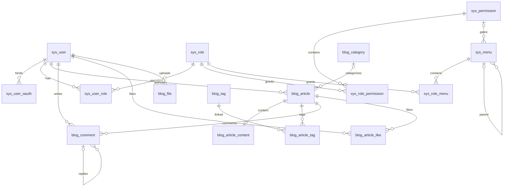

# DriftingLeavesV2 数据库设计

适用 MySQL **8.0.16+**，InnoDB、utf8mb4。设计日期：2026-10-29。

这是新项目的空库建库基线。当前 `Backend/` 已实现 18 表实体、Sa-Token + JustAuth 身份基础闭环及 API 第 1..4 章（含后台用户与角色授权管理）；博客业务和其他后台管理 CRUD 仍待实现，`Front/` 尚无前端工程。运行与隔离测试见 [后端运行说明](../docs/后端运行说明.md)。

## 文件与执行

- `drifting_leaves_v2.sql`：18 张表、基础角色、权限字典、后台菜单和站点配置。

在 MySQL 客户端执行（路径可按实际位置修改）：

```sql
SOURCE D:/CodingFiles/Blog/DriftingLeavesV2/sql/drifting_leaves_v2.sql;
```

脚本选择 `drifting_leaves_v2` 库，要求该库不存在或为空；不会删除旧库、旧表，也不是可重复执行的迁移脚本。DDL 不具备整份事务回滚能力，导入失败应在干净的开发库重新执行，不要用 `--force` 忽略错误。

没有初始化用户或默认密码。首位管理员须由受控运维流程使用本项目 BCrypt 编码器创建（当前无自动初始化入口），再在同一事务内为其关联 `role_id=1`。`password_hash` 预留 255 字节，允许为 NULL（未设置本站密码）；非 NULL 时保留长度检查，具体编码格式仍由密码编码器验证。密码注册必须写入有效哈希，密码登录必须拒绝哈希为 NULL 的账号，不能写空字符串或公共默认密码。公开注册（含第三方首次注册）固定分配 `member`，不能接受请求体中的角色、权限、账号状态。

## 参考来源与取舍

已读取所提供 `D:/DefaultFolder/File/soft_manage.sql` 中五张权限相关表的 DDL，仅将其当作设计资料，不导入其中人员、账号或业务记录。

| 来源 | 实际检查的结构 | 本设计采用/调整 |
| --- | --- | --- |
| `soft_manage.sql` | `sys_user`、`sys_role`、`sys_menu`、`sys_user_role`、`sys_role_menu`；菜单含父节点、编码、图标、路由、组件、类型、排序、状态、是否导航 | 保留角色码、菜单树和多对多授权；关联表改为复合主键；增加外键；统一状态；不采用权重隐式继承 |
| [Jzjzzzz/vblog 的 SQL](https://github.com/Jzjzzzz/vblog/blob/8f701f113b17fdec3f871719255bc65d009968f7/db/vblog.sql) | `sys_menu` 的目录/菜单/按钮类型、`perms` 字段、角色及关联表；文章信息/正文拆分 | 采用三类菜单节点和正文拆分；权限码从菜单字符串提取为独立字典；不复制部门、岗位、题库和 Quartz 等外围表 |
| [asdfexec/blog 的 SQL](https://github.com/asdfexec/blog/blob/d3494d79b94b932fccbfe5dd8e4fb49f14e1d525/blog-mysql8.sql)（infocodingonline/blog 的分支） | `tb_menu`、`tb_resource`、`tb_role_menu`、`tb_role_resource`、`tb_article_tag` | 采用菜单授权与接口权限分离、标签关联表；本项目以权限码关联后端接口，不复制动态 URL 资源树或第三方登录/聊天/相册表 |

GitHub 版本按上述提交固定。这里没有复制参考项目的业务数据、凭据或完整建表文件。

## 表与关系

| 分组 | 表 | 用途 |
| --- | --- | --- |
| 身份 | `sys_user` | 登录账号、密码哈希、资料、启停状态 |
| 第三方身份 | `sys_user_oauth` | JustAuth平台身份与本站用户绑定；每用户每平台一个账号 |
| 角色 | `sys_role`、`sys_user_role` | 多角色、状态、内容数据范围 |
| 接口权限 | `sys_permission`、`sys_role_permission` | 独立权限码及角色授权，接口可复用同一权限码 |
| 后台菜单 | `sys_menu`、`sys_role_menu` | 目录、页面、按钮树及角色可访问节点 |
| 文章 | `blog_article`、`blog_article_content` | 元数据、正文一对一；草稿/发布/下架、公开/私密、回收站 |
| 分类标签 | `blog_category`、`blog_tag`、`blog_article_tag` | 一篇文章一个可选分类、多个标签 |
| 互动 | `blog_comment`、`blog_article_like` | 登录评论、同文章回复、审核、每用户每文章一次点赞 |
| 站点 | `blog_friend_link`、`blog_file`、`blog_site_config` | 友链、文件元数据、显式可公开的配置 |



`blog_article_content` 的外键只保证正文对应文章，无法反向保证每篇文章都有正文；创建/编辑文章、正文与标签必须在一个业务事务中完成。

## Sa-Token + JustAuth 接入约定

JustAuth 负责第三方授权及用户身份获取，Sa-Token 负责本站会话和权限检查。绑定表按 [JustAuth 的账号整合建议](https://www.justauth.cn/features/integrate-existing-systems/) 使用 `source + uuid` 唯一确定第三方身份；本项目将身份与用户关联收敛为一张表，不保存第三方 Token 或完整用户资料副本。

- `sys_user_oauth.user_id` 指向本站账号；`source` 由服务端的平台白名单确定，统一使用 `QQ`、`GITHUB`、`GITEE` 等大写标识；`uuid` 取服务端验证成功的 JustAuth `AuthUser.uuid`，区分大小写，不接受前端提交的身份作为登录依据。
- 唯一键 `(source, uuid)` 防止同一第三方身份绑定多个本站用户；`(user_id, source)` 限制每个用户在同平台仅绑定一个账号，也支持同一用户绑定多个不同平台。外键防止孤立绑定，物理删除用户时级联清理；正常停用账号仍使用 `sys_user.status`。
- 当前每个平台仅配置一个第三方应用。QQ 等平台的 openid 可能受应用范围限制；以后同一平台接入多个应用时，需增加应用标识并重新设计唯一键。上线后不要直接切换 JustAuth 的身份生成策略（如 QQ 的 openid/unionid 选择），应先迁移既有绑定，避免同一用户被识别为新账号。
- 第三方首次注册时由本站生成唯一 `username`（不直接沿用第三方昵称），`password_hash` 保持 NULL；昵称、头像经校验后用于初始化，邮箱未独立验证前保持 NULL。创建用户、绑定身份、分配 `member` 在同一事务内完成；并发回调冲突应回滚，再按唯一身份重新查询，不能覆盖绑定归属。
- 登录回调验证授权结果及 `state`，查询绑定并检查本站账号，生成一次性 ticket 后回跳固定完成页；exchange 在用户行锁中重查绑定和启用状态，再通过 Sa-Token 创建会话。密码登录和第三方登录均使用本站 `user_id`，第三方 access_token 不作为本站凭据。
- `state` 必须关联发起请求的浏览器会话、操作类型（登录/绑定）及绑定目标用户，短期有效且使用后失效；多实例部署使用共享缓存。不能关闭 state 校验，也不能仅凭相同昵称或邮箱自动合并账号。
- 绑定已有账号须先验证本站身份，目标 `user_id` 从会话读取；设置首个密码也需验证当前身份。解绑或清除密码时锁定用户记录，在同一事务内保证至少保留一种可用登录方式，禁止无密码用户解绑最后一个第三方账号。此跨表规则由应用保证，SQL CHECK 无法代替。
- Sa-Token 会话、权限缓存以及 JustAuth state 缓存由框架及 Redis 等缓存管理，无需新增业务 Token 表；第三方 App ID/Secret 放在后端配置或密钥管理中，不写入站点配置表。当前只做登录，不长期保存第三方 access_token/refresh_token。

## 权限与菜单规则

### 默认角色

| 角色码 | 后台菜单 | 接口权限 | 数据范围 |
| --- | --- | --- | --- |
| `admin` | 全部后台目录、页面和按钮 | 初始化时全部权限，后续新增权限显式授予 | ALL |
| `author` | 内容目录、文章、分类只读、标签只读、文件及获授操作按钮 | 后台入口、文章管理、分类/标签查询、文件管理、前台互动 | SELF |
| `member` | 无 | 发表评论、删除本人评论、点赞/取消点赞 | SELF |

匿名访客不是一个数据库角色。前台阅读公开文章、展示分类/标签及友链由公开接口处理；个人资料修改、修改密码、当前登录用户菜单/权限查询走“已登录且操作本人”的接口，不开放按任意用户 ID 查询。

### 后端接口鉴权

权限码采用 `模块:资源:动作`，大小写敏感，例如 `blog:article:update`。实现 Sa-Token `StpInterface`，分别返回有效角色的 `role_code` 和有效权限的 `permission_code`；角色码不加 `ROLE_` 前缀。后端注册 Sa-Token 拦截器并明确公开接口白名单，再启用注解/路由鉴权；仅添加数据库记录不会自动保护接口。

接口与权限码由后端控制器或方法注解绑定。本设计不存 `HTTP method + URL` 映射表，路由改变不应改变角色授权。一个逻辑操作的列表/详情、上传单个/批量等接口可以复用权限码。身份、后台用户与角色授权接口已实现，见 API 第 1..4 章；下表其余后台与博客操作仍为后续实现约定：

| 操作 | 所需检查 |
| --- | --- |
| 后台文章列表、详情 | 登录 + `admin:access` + `blog:article:query` + 当前操作的数据范围 |
| 后台新建文章 | 登录 + `admin:access` + `blog:article:create`；作者固定为当前用户 |
| 后台编辑/回收/恢复文章 | 登录 + `admin:access` + 对应 `update/delete/restore` 权限 + 文章归属 |
| 发布、下架，或编辑时改变发布状态 | 另外检查 `blog:article:publish`，不能借编辑接口绕过 |
| 上传/列出/删除文件 | 登录 + `admin:access` + 对应 `blog:file:*` 权限；SELF 限本人上传文件 |
| 审核/管理删除任意评论 | 登录 + `admin:access` + `blog:comment:review/moderate`；SELF 只管理本人文章下的评论 |
| 前台删除本人评论 | 登录 + `blog:comment:deleteOwn` + `comment.user_id = 当前用户`，不受 ALL 扩大 |
| 评论、点赞 | 对应权限 + 目标文章公开、已发布、未删除；评论还需站点及文章允许评论 |
| 分配用户角色 | 登录 + `admin:access` + `sys:user:assignRole`；普通资料更新不能写入角色 |
| 配置角色菜单/权限 | 登录 + `admin:access` + `sys:role:grant`；事务写入两类授权 |
| 前台阅读文章 | `status=1 AND visibility=1 AND deleted_at IS NULL AND publish_time <= 当前时间`；详情、搜索、归档、标签页、评论列表都使用这一条件 |

未声明为公开的业务接口默认拒绝匿名访问；后台接口均需要 `admin:access` 和业务权限，登录本身不授予后台权限。前端隐藏菜单、传入权限码或修改请求参数均不能替代服务端检查。非公开文章若需要作者预览，使用经过文章查询权限和归属检查的后台接口。

当前用户的有效权限查询（参数 `?` 为服务端会话中的 user_id）：

```sql
SELECT DISTINCT p.permission_code
FROM sys_user u
JOIN sys_user_role ur ON ur.user_id = u.user_id
JOIN sys_role r ON r.role_id = ur.role_id AND r.status = 1
JOIN sys_role_permission rp ON rp.role_id = r.role_id
JOIN sys_permission p ON p.permission_id = rp.permission_id AND p.status = 1
WHERE u.user_id = ? AND u.status = 1;
```

数据范围只从**授予当前操作权限**的有效角色求并集：其中任一角色为 ALL 则可操作全部，否则仅 SELF。不能把用户另外一个没有此权限的 ALL 角色用于扩大当前操作范围。对文章编辑/删除/恢复等，在实际 SQL 的 `WHERE` 中加入 `author_id=当前用户`，批量操作逐项遵守；文件使用 `uploader_id`，评论管理使用其文章的 `author_id`。分类、标签、友链、配置和系统权限属于全局操作，SELF 不产生“仅本人”版本；授予时应明确它们的全局影响。

### 菜单计算

1. 检查账号启用并拥有有效 `admin:access`；只取有效角色在 `sys_role_menu` 授予的节点。
2. 页面/按钮还必须具有 `permission_id` 对应的有效权限；目录为空权限，仅作为结构。这里权限取用户所有有效角色的并集。
3. 按祖先链检查授权和状态，任一祖先未授权/禁用就不返回该分支；剔除没有可访问页面的空目录，按 `sort_order, menu_id` 排序。
4. `is_visible=0` 仅隐藏导航，仍可作为已授权路由；按钮不生成路由，操作能力取有效按钮与权限的交集。
5. 返回的数据由前端组件白名单解析 `component`，不可把数据库字符串当作任意代码/远程模块执行。

`path` 是 Vue 路由，绝不是后端鉴权匹配规则。数据库外键保证父节点存在，不能保证树无环、父节点类型正确；菜单写入时必须检查自引用、移动到后代、按钮不能成为父节点、页面/按钮不能跨不合理层级，并在一个事务内保存。删除父菜单前处理子节点。角色权限与菜单保存已通过同一 grants 事务完整替换，补全祖先并返回最终集合；所选节点及祖先须存在、启用且无环、父类型正确，页面/按钮门禁须显式配置，不能静默放行。等价最终集合保留版本及会话。

停用账号、角色、权限及调整授权后，后端必须使相关登录态/权限缓存失效或重新加载；菜单缓存也要刷新。禁用菜单只影响导航和路由，不撤销独立的接口权限；彻底撤权应删除 `sys_role_permission` 或停用该权限。用户及角色写事务共用固定保护锁、升序用户锁和最后有效管理员检查，防止并发把管理入口全部关闭。角色范围、状态或授权变化及自定义角色删除撤销全部关联用户会话，Redis 失败回滚数据库。角色删除沿用三类关联外键 CASCADE；admin/author/member 禁止删除，角色码创建后不可改。本次无需 SQL 表结构变更。

## 数据约束与生命周期

- 主键统一有符号 BIGINT 自增，对应 Java Long；前端 ID 以字符串传输，避免超出 JavaScript 安全整数范围。
- 普通启停状态统一为 `0禁用/隐藏、1启用/展示`，文章、评论、友链的流程状态在字段注释中分别定义。
- 仅文章使用 `deleted_at` 回收站；账号停用、角色/权限启停，关联表直接物理增删，不叠加逻辑删除标志。回收站文章的 slug 不复用，恢复时不会与新文章冲突。
- 外键使用 RESTRICT 保护作者、评论、菜单引用；纯关联表及文章正文随主记录 CASCADE 删除；分类删除后文章分类 SET NULL。文章永久清理须先按回复链从叶子清理评论，再删除文章；应用普通删除只写回收站时间。
- 评论父节点使用 `(parent_id, article_id)` 复合外键，阻止跨文章回复；父节点写入时由服务端验证已通过审核且可见，回复关系创建后不允许修改，避免环。作者删除评论时写固定占位内容并置 `status=3`，回复链保留；前台不得输出待审/驳回内容，占位节点只显示占位文案。
- 点赞/用户角色/角色菜单/角色权限/文章标签都用复合主键去重；不维护易失真的点赞数和评论数副本，按明细统计。浏览数可原子递增。
- 时间统一由应用/连接使用约定时区（建议 UTC）；DATETIME 不自动转换时区，部署时连接、应用和展示要保持一致。发布状态必须有发布时间；禁止未来发布时间的规则由发布接口验证。
- 文章索引覆盖前台状态过滤、分类筛选、作者管理；评论覆盖文章展示、用户查询及审核队列；菜单覆盖父节点排序。未增加未经需求证明的全文搜索/访问日志表，中文检索方案后续按实际查询选择。
- `blog_file` 记录存储键，不保存对象存储密钥。文件类型、大小、路径安全、私密文章附件访问和“文件仍被文章引用时能否删除”由应用/存储层校验；数据库中的元数据不代表文件已经上传成功，存储删除失败需保留元数据供重试。
- 公开配置接口只返回 `is_public=1`，后台允许修改的配置键/字段采用白名单；不把邮件、数据库、云存储凭据放入站点配置。密码哈希不出现在用户查询响应中，文章 HTML 渲染需要过滤不安全内容。

暂未引入组织部门、租户、聊天、相册、文章版本、独立归档表和额外鉴权会话表；这些不属于当前项目的必需部分。第三方登录仅增加身份绑定，Session/Token 由 Sa-Token 及其存储管理。

## 当前实体映射

全部 18 表均在 `Backend/entity/src/main/java/com/xuan/entity/` 显式映射，不共享虚构时间基类。主外键用 Long，`view_count` / `size_bytes` 用 BigInteger 覆盖 UNSIGNED 上限，站点 `config_value` 用原始 JSON String，解析留在应用层。五类复合主键实体不声明 `@TableId`，本期不为它们建立 BaseMapper；用户角色关联通过明确 SQL 插入。

时间默认值和更新时间由 MySQL 维护，应用不做重复填充，连接初始化为 UTC。身份写事务使用 READ COMMITTED，授权/菜单读取使用一致快照。测试只向新建的隔离实例导入本基线，没有执行开发或业务数据库初始化。
