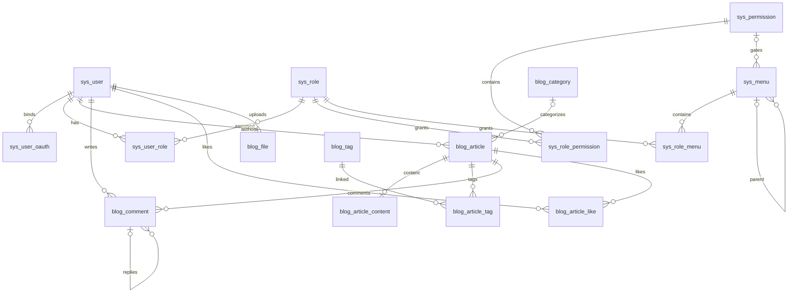

# DriftingLeavesV2 数据库设计

当前实现状态（2026-10-31，Asia/Shanghai）：API中153个方法/路径均已有实际消费者，28张表已有实体，55个后台写方法接入事务审计。第15..20章新增66入口及主页/简历、留言私密父链、音乐、订阅邮箱确认、PUBLIC XML、访问/UTC统计与日志治理已实现。当前轮完整验收结果见本文末尾；下方较早分章记录为历史状态，不再限制本轮范围。


适用 MySQL **8.0.16+**，InnoDB、utf8mb4。更新日期：2026-10-31。

这是新项目的空库建库基线，现有28张表已全部映射。API共153个方法/路径，55个后台写方法接入成功同事务、失败回滚后独立审计。主页/简历、留言、音乐、订阅、访客与浏览已有真实业务消费者；文件HTTP与文章/存储已接通，日志有独立ALL查询与清理。`Front/`尚无前端工程。本轮沿用现有表、约束、索引、权限/菜单种子，不修改SQL结构，不向业务库导入基线。分类删除SET NULL、标签关联CASCADE，文章/正文保留并改变聚合版本；互动按真实明细计数，访问PV/UV按保留明细，不反向扣减文章累计阅读。运行与隔离验证见[后端运行说明](../docs/后端运行说明.md)。

## 文件与执行

- `drifting_leaves_v2.sql`：28 张表、基础角色、权限字典、后台菜单和站点配置；这是要求空库的初始化基线，不是增量迁移脚本。

在 MySQL 客户端执行（路径可按实际位置修改）：

```sql
SOURCE D:/CodingFiles/Blog/DriftingLeavesV2/sql/drifting_leaves_v2.sql;
```

脚本选择 `drifting_leaves_v2` 库，要求该库不存在或为空；不会删除旧库、旧表，也不是可重复执行的迁移脚本。DDL 不具备整份事务回滚能力，导入失败应在干净的开发库重新执行，不要用 `--force` 忽略错误。

没有初始化用户或默认密码。首位管理员须由受控运维流程使用本项目 BCrypt 编码器创建（当前无自动初始化入口），再在同一事务内为其关联 `role_id=1`。`password_hash` 预留 255 字节，允许为 NULL（未设置本站密码）；非 NULL 时保留长度检查，具体编码格式仍由密码编码器验证。密码注册必须写入有效哈希，密码登录必须拒绝哈希为 NULL 的账号，不能写空字符串或公共默认密码。公开注册（含第三方首次注册）固定分配 `member`，不能接受请求体中的角色、权限、账号状态。

## 参考来源与取舍

已读取所提供 `D:/DefaultFolder/File/soft_manage.sql` 中五张权限相关表的 DDL，仅将其当作设计资料，不导入其中人员、账号或业务记录。

| 来源 | 实际检查的结构 | 本设计采用/调整 |
| --- | --- | --- |
| `soft_manage.sql` | `sys_user`、`sys_role`、`sys_menu`、`sys_user_role`、`sys_role_menu`；菜单含父节点、编码、图标、路由、组件、类型、排序、状态、是否导航 | 保留角色码、菜单树和多对多授权；关联表改为复合主键；增加外键；统一状态；不采用权重隐式继承 |
| [Jzjzzzz/vblog 的 SQL](https://github.com/Jzjzzzz/vblog/blob/8f701f113b17fdec3f871719255bc65d009968f7/db/vblog.sql) | `sys_menu` 的目录/菜单/按钮类型、`perms` 字段、角色及关联表；文章信息/正文拆分 | 采用三类菜单节点和正文拆分；权限码从菜单字符串提取为独立字典；不复制部门、岗位、题库和 Quartz 等外围表 |
| [asdfexec/blog 的 SQL](https://github.com/asdfexec/blog/blob/d3494d79b94b932fccbfe5dd8e4fb49f14e1d525/blog-mysql8.sql)（infocodingonline/blog 的分支） | `tb_menu`、`tb_resource`、`tb_role_menu`、`tb_role_resource`、`tb_article_tag` | 采用菜单授权与接口权限分离、标签关联表；本项目以权限码关联后端接口，不复制动态 URL 资源树或第三方登录/聊天/相册表 |

GitHub 版本按上述提交固定。这里没有复制参考项目的业务数据、凭据或完整建表文件。

本次对照用户提供的 `D:/CodingFiles/Blog/DriftingLeaves/DL-server/src/main/resources/sql/DriftingLeaves.sql`，并检查 `D:/CodingFiles/Blog/DriftingLeaves-Website` 的建表、完整性迁移、前端 API 和后端控制器。旧文件仅作为功能资料，不执行其中的账号或配置初始化指令，不复制账号、密码或业务数据。新增对应关系如下：

| 旧表/功能 | 当前基线 | 适配现有鉴权 |
| --- | --- | --- |
| `personal_info`、`social_media` | `home_profile`、`home_social_link` | 单站主人展示资料、社交链接；公开联系邮箱独立于登录邮箱 |
| `experiences`、`skills` | `cv_experience`、`cv_skill` | 教育/工作/项目经历与技能，后台显式授权 |
| `messages` | `blog_message` | 本站用户留言/回复、审核、悄悄话、编辑与删除占位 |
| `music` | `blog_music` | 音频、封面、可选歌词、排序和展示状态 |
| `rss_subscriptions` | `blog_rss_subscription` | 绑定本站用户，邮箱唯一且确认后才激活 |
| `visitors`、`views` | `blog_visitor`、`blog_page_view` | 匿名访问统计与可选本站用户关联；统计标识不授予身份权限 |
| `operation_logs` | `sys_operation_log` | 关联本站操作人，脱敏记录操作及权限码快照 |
| 统计报表 | 新增查询权限和菜单，复用浏览明细 | 仅显式授权的后台用户访问 |

旧 `admin` 和访客 Token 不移植；现有 `sys_user`、RBAC、Sa-Token 和 JustAuth 保持原结构。系统配置继续使用 `blog_site_config`；备案与建站日期补入公开 `site` 配置。RSS XML、Sitemap、归档、字数和阅读时长可从文章数据生成，不另建重复表；旧计数同步批次属于未采用的实现机制，不复制。

## 表与关系

| 分组 | 表 | 用途 |
| --- | --- | --- |
| 身份 | `sys_user` | 登录账号、密码哈希、资料、启停状态 |
| 第三方身份 | `sys_user_oauth` | JustAuth平台身份与本站用户绑定；每用户每平台一个账号 |
| 角色 | `sys_role`、`sys_user_role` | 多角色、状态、内容数据范围 |
| 接口权限 | `sys_permission`、`sys_role_permission` | 独立权限码及角色授权，接口可复用同一权限码 |
| 后台菜单 | `sys_menu`、`sys_role_menu` | 目录、页面、按钮树及角色可访问节点 |
| 文章 | `blog_article`、`blog_article_content` | 元数据、正文一对一；草稿/发布/下架、公开/私密、回收站 |
| 分类标签 | `blog_category`、`blog_tag`、`blog_article_tag` | 一篇文章一个可选分类、多个标签 |
| 互动 | `blog_comment`、`blog_article_like` | 登录评论、同文章回复、审核、每用户每文章一次点赞 |
| 站点 | `blog_friend_link`、`blog_file`、`blog_site_config` | 友链、文件元数据、显式可公开的配置 |
| 主页 | `home_profile`、`home_social_link` | 单站主人展示资料、社交链接 |
| 简历 | `cv_experience`、`cv_skill` | 教育/工作/项目经历、技能 |
| 留言与音乐 | `blog_message`、`blog_music` | 独立留言回复树、背景音乐 |
| 邮件订阅 | `blog_rss_subscription` | 本站用户、独立确认的订阅邮箱及订阅状态 |
| 访问统计 | `blog_visitor`、`blog_page_view` | 访客、跨站点浏览明细、时间段文章排行 |
| 审计 | `sys_operation_log` | 管理操作、结果和脱敏摘要 |



`blog_article_content` 的外键只保证正文对应文章，无法反向保证每篇文章都有正文；创建/编辑文章、正文与标签必须在一个业务事务中完成。

## Sa-Token + JustAuth 接入约定

JustAuth 负责第三方授权及用户身份获取，Sa-Token 负责本站会话和权限检查。绑定表按 [JustAuth 的账号整合建议](https://www.justauth.cn/features/integrate-existing-systems/) 使用 `source + uuid` 唯一确定第三方身份；本项目将身份与用户关联收敛为一张表，不保存第三方 Token 或完整用户资料副本。

- `sys_user_oauth.user_id` 指向本站账号；`source` 由服务端的平台白名单确定，统一使用 `QQ`、`GITHUB`、`GITEE` 等大写标识；`uuid` 取服务端验证成功的 JustAuth `AuthUser.uuid`，区分大小写，不接受前端提交的身份作为登录依据。
- 唯一键 `(source, uuid)` 防止同一第三方身份绑定多个本站用户；`(user_id, source)` 限制每个用户在同平台仅绑定一个账号，也支持同一用户绑定多个不同平台。外键防止孤立绑定，物理删除用户时级联清理；正常停用账号仍使用 `sys_user.status`。
- 当前每个平台仅配置一个第三方应用。QQ 等平台的 openid 可能受应用范围限制；以后同一平台接入多个应用时，需增加应用标识并重新设计唯一键。上线后不要直接切换 JustAuth 的身份生成策略（如 QQ 的 openid/unionid 选择），应先迁移既有绑定，避免同一用户被识别为新账号。
- 第三方首次注册时由本站生成唯一 `username`（不直接沿用第三方昵称），`password_hash` 保持 NULL；昵称、头像经校验后用于初始化，邮箱未独立验证前保持 NULL。创建用户、绑定身份、分配 `member` 在同一事务内完成；并发回调冲突应回滚，再按唯一身份重新查询，不能覆盖绑定归属。
- 登录回调验证授权结果及 `state`，查询绑定并检查本站账号，生成一次性 ticket 后回跳固定完成页；exchange 在用户行锁中重查绑定和启用状态，再通过 Sa-Token 创建会话。密码登录和第三方登录均使用本站 `user_id`，第三方 access_token 不作为本站凭据。
- `state` 必须关联发起请求的浏览器会话、操作类型（登录/绑定）及绑定目标用户，短期有效且使用后失效；多实例部署使用共享缓存。不能关闭 state 校验，也不能仅凭相同昵称或邮箱自动合并账号。
- 绑定已有账号须先验证本站身份，目标 `user_id` 从会话读取；设置首个密码也需验证当前身份。解绑或清除密码时锁定用户记录，在同一事务内保证至少保留一种可用登录方式，禁止无密码用户解绑最后一个第三方账号。此跨表规则由应用保证，SQL CHECK 无法代替。
- Sa-Token 会话、权限缓存以及 JustAuth state 缓存由框架及 Redis 等缓存管理，无需新增业务 Token 表；第三方 App ID/Secret 放在后端配置或密钥管理中，不写入站点配置表。当前只做登录，不长期保存第三方 access_token/refresh_token。

## 权限与菜单规则

### 默认角色

| 角色码 | 后台菜单 | 接口权限 | 数据范围 |
| --- | --- | --- | --- |
| `admin` | 全部后台目录、页面和按钮 | 初始化时全部权限，后续新增权限显式授予 | ALL |
| `author` | 内容目录、文章、分类只读、标签只读、文件及获授操作按钮 | 后台入口、文章管理、分类/标签查询、文件管理、前台互动、本人留言与邮件订阅 | SELF |
| `member` | 无 | 发表评论、删除本人评论、点赞/取消点赞、发表/编辑/删除本人留言、本人订阅/退订 | SELF |

匿名访客不是一个数据库角色。前台阅读公开文章、展示分类/标签及友链由公开接口处理；个人资料修改、修改密码、当前登录用户菜单/权限查询走“已登录且操作本人”的接口，不开放按任意用户 ID 查询。

### 后端接口鉴权

权限码采用 `模块:资源:动作`，大小写敏感，例如 `blog:article:update`。实现 Sa-Token `StpInterface`，分别返回有效角色的 `role_code` 和有效权限的 `permission_code`；角色码不加 `ROLE_` 前缀。后端注册 Sa-Token 拦截器并明确公开接口白名单，再启用注解/路由鉴权；仅添加数据库记录不会自动保护接口。

接口与权限码由后端控制器或方法注解绑定。本设计不存 `HTTP method + URL` 映射表，路由改变不应改变角色授权。一个逻辑操作的列表/详情、上传单个/批量等接口可以复用权限码。身份、系统管理、文章、分类标签、评论点赞、友链配置和文件已实现，见 API 第 1..11 章；下表其他后续模块仍为实现约定：

| 操作 | 所需检查 |
| --- | --- |
| 后台文章列表、详情 | 登录 + `admin:access` + `blog:article:query` + 当前操作的数据范围 |
| 后台新建文章 | 登录 + `admin:access` + `blog:article:create`；作者固定为当前用户 |
| 后台编辑/回收/恢复文章 | 登录 + `admin:access` + 对应 `update/delete/restore` 权限 + 文章归属 |
| 发布、下架，或编辑时改变发布状态 | 另外检查 `blog:article:publish`，不能借编辑接口绕过 |
| 上传/列出/删除文件 | 登录 + `admin:access` + 对应 `blog:file:*` 权限；SELF 限本人上传文件 |
| 审核/管理删除任意评论 | 登录 + `admin:access` + `blog:comment:review/moderate`；SELF 只管理本人文章下的评论 |
| 前台删除本人评论 | 登录 + `blog:comment:deleteOwn` + `comment.user_id = 当前用户`，不受 ALL 扩大 |
| 评论、点赞 | 对应权限 + 目标文章公开、已发布、未删除；评论还需站点及文章允许评论 |
| 分配用户角色 | 登录 + `admin:access` + `sys:user:assignRole`；普通资料更新不能写入角色 |
| 配置角色菜单/权限 | 登录 + `admin:access` + `sys:role:grant`；事务写入两类授权 |
| 前台阅读文章 | `status=1 AND visibility=1 AND deleted_at IS NULL AND publish_time <= 当前时间`；详情、搜索、归档、标签页、评论列表都使用这一条件 |

未声明为公开的业务接口默认拒绝匿名访问；后台接口均需要 `admin:access` 和业务权限，登录本身不授予后台权限。前端隐藏菜单、传入权限码或修改请求参数均不能替代服务端检查。非公开文章若需要作者预览，使用经过文章查询权限和归属检查的后台接口。

当前用户的有效权限查询（参数 `?` 为服务端会话中的 user_id）：

```sql
SELECT DISTINCT p.permission_code
FROM sys_user u
JOIN sys_user_role ur ON ur.user_id = u.user_id
JOIN sys_role r ON r.role_id = ur.role_id AND r.status = 1
JOIN sys_role_permission rp ON rp.role_id = r.role_id
JOIN sys_permission p ON p.permission_id = rp.permission_id AND p.status = 1
WHERE u.user_id = ? AND u.status = 1;
```

数据范围只从**授予当前操作权限**的有效角色求并集：其中任一角色为 ALL 则可操作全部，否则仅 SELF。不能把用户另外一个没有此权限的 ALL 角色用于扩大当前操作范围。对文章编辑/删除/恢复等，在实际 SQL 的 `WHERE` 中加入 `author_id=当前用户`，批量操作逐项遵守；文件使用 `uploader_id`，评论管理使用其文章的 `author_id`。分类、标签、友链、配置和系统权限属于全局操作，SELF 不产生“仅本人”版本；授予时应明确它们的全局影响。

新增模块继续采用独立权限和菜单授权。`home:profile:*`、`home:social:*`、`cv:experience:*`、`cv:skill:*`、`blog:music:*`，以及留言审核、订阅管理、访客/浏览/报表和日志均为全站资源，后台接口需 `admin:access`、对应权限及 ALL 范围；SELF 不生成虚构的归属条件。新增权限仅管理员默认获得这些管理能力；作者和会员只新增 `blog:message:create/updateOwn/deleteOwn`、`blog:rss:subscribe/unsubscribe`，共 5 项前台权限。本人接口始终按会话 `user_id` 限定，不能被 ALL 扩大。

新增模块逐接口契约已补入[API文档](../docs/API.md)第15..20章，旧业务取舍见该文档第21章。新菜单的组件键均为后续前端实现约定。第15..20章已有对应Controller、Service和Mapper/XML，后台独立权限及ALL、本人归属SQL均在实际消费者中检查。

### 菜单计算

1. 检查账号启用并拥有有效 `admin:access`；只取有效角色在 `sys_role_menu` 授予的节点。
2. 页面/按钮还必须具有 `permission_id` 对应的有效权限；目录为空权限，仅作为结构。这里权限取用户所有有效角色的并集。
3. 按祖先链检查授权和状态，任一祖先未授权/禁用就不返回该分支；剔除没有可访问页面的空目录，按 `sort_order, menu_id` 排序。
4. `is_visible=0` 仅隐藏导航，仍可作为已授权路由；按钮不生成路由，操作能力取有效按钮与权限的交集。
5. 返回的数据由前端组件白名单解析 `component`，不可把数据库字符串当作任意代码/远程模块执行。

`path` 是 Vue 路由，绝不是后端鉴权匹配规则。数据库外键保证父节点存在，不能保证树无环、父节点类型正确；菜单写入已在同一 READ COMMITTED 事务先锁 `sys_role(role_id=1)` 结构检查点，再升序锁操作者及受影响分支关联用户、锁目标节点，复核原 Token、启用身份、双权限和业务版本，检查自引用、移入后代、完整祖先链及类型变更对全部后代的约束。字段严格按 D/M/B 形状及当前 SQL 种子的组件/图标白名单校验；允许在禁用父节点下维护结构，M/B 可引用已存在但停用的权限，本人树实时过滤。完整 PUT 显式清空 NULL，不改 menu_code；有任意状态子节点删除返回 RESOURCE_IN_USE，叶子仅级联 role_menu，关联角色聚合版本随之变化，不删除 role_permission 或撤销会话。后台完整树保留禁用、隐藏、按钮和空目录。移动不自动补角色祖先，修改门禁不授予新权限。角色权限与菜单保存已通过同一 grants 事务完整替换，补全祖先并返回最终集合；所选节点及祖先须存在、启用且无环、父类型正确，页面/按钮门禁须显式配置，不能静默放行。等价最终集合保留版本及会话。

停用账号、角色、权限及调整授权后，后端必须使相关登录态/权限缓存失效或重新加载；菜单缓存也要刷新。禁用菜单只影响导航和路由，不撤销独立的接口权限；彻底撤权应删除 `sys_role_permission` 或停用该权限。用户及角色写事务共用固定保护锁、升序用户锁和最后有效管理员检查，防止并发把管理入口全部关闭。角色范围、状态或授权变化及自定义角色删除撤销全部关联用户会话，Redis 失败回滚数据库。角色删除沿用三类关联外键 CASCADE；admin/author/member 禁止删除，角色码创建后不可改。管理员保护仍使用 `AuthorizationProvider.ADMIN_PERMISSIONS` 的固定用户、角色、菜单、权限管理白名单，新增日志权限不自动纳入保护条件。权限字典写入复用同一保护锁与升序关联用户锁，再锁目标权限。权限码创建后不可改；固定后端权限禁止删除（409/STATE_CONFLICT），白名单不随 SQL 新增字典项自动扩大。任意状态菜单引用权限时禁止删除（409/RESOURCE_IN_USE），保留菜单 RESTRICT 外键；其余权限删除由角色关联 CASCADE 清理，先撤销全部关联用户的所有会话再提交。权限状态变化也撤销全部关联用户会话（含禁用角色、禁用用户），但保留角色授权及菜单门禁引用；Redis 失败使数据库整笔回滚。

## 数据约束与生命周期

- 主键统一有符号 BIGINT 自增，对应 Java Long；前端 ID 以字符串传输，避免超出 JavaScript 安全整数范围。
- 普通启停状态统一为 `0禁用/隐藏、1启用/展示`，文章、评论、友链的流程状态在字段注释中分别定义。
- 仅文章使用 `deleted_at` 回收站；账号停用、角色/权限启停，关联表直接物理增删，不叠加逻辑删除标志。回收站文章的 slug 不复用，恢复时不会与新文章冲突。
- 外键使用 RESTRICT 保护作者、评论、菜单引用；纯关联表及文章正文随主记录 CASCADE 删除；分类删除后文章分类 SET NULL。文章永久清理须先按回复链从叶子清理评论，再删除文章；应用普通删除只写回收站时间。
- 评论父节点使用 `(parent_id, article_id)` 复合外键，阻止跨文章回复；父节点写入时由服务端验证已通过审核且可见，回复关系创建后不允许修改，避免环。作者删除评论时写固定占位内容并置 `status=3`，回复链保留；前台不得输出待审/驳回内容，占位节点只显示占位文案。
- 点赞/用户角色/角色菜单/角色权限/文章标签都用复合主键去重；不维护易失真的点赞数和评论数副本，按明细统计。浏览数可原子递增。
- 第9章已用真实明细实现评论/点赞：评论写入先锁操作者、comment配置、文章及评论；点赞先锁操作者再锁文章，全部写事务为 READ COMMITTED。锁后复核原Token、独立操作范围和状态。comment配置只接受不公开、最多16KiB的两项布尔值enabled/reviewRequired，缺失或格式异常返回503；第10章提供配置维护HTTP，与评论写入锁同一配置行。公开评论、回复入口和文章计数共用完整祖先链；0/2隐藏分支，3固定占位且公开/后台author=null，计数不含占位。本人删除固定user_id，后台query/review/moderate分别在SQL限制文章author_id。审核版本包含持久化业务字段，两种占位删除无版本要求。blog_article_like按完整复合键幂等插入/删除，文章列表、详情和热门榜实时取数，互动不改变文章X-Revision。
- 时间统一由应用/连接使用约定时区（建议 UTC）；DATETIME 不自动转换时区，部署时连接、应用和展示要保持一致。发布状态必须有发布时间；禁止未来发布时间的规则由发布接口验证。
- 文章索引覆盖前台状态过滤、分类筛选、作者管理；评论覆盖文章展示、用户查询及审核队列；菜单覆盖父节点排序。新增浏览明细覆盖站点/路径、访客、用户、文章与时间查询；中文全文检索仍按实际查询选择。
- `blog_file` 记录存储键，不保存对象存储密钥。文件类型、大小、路径安全、私密文章附件访问和“文件仍被文章引用时能否删除”由应用/存储层校验；数据库中的元数据不代表文件已经上传成功，存储删除失败需保留元数据供重试。
- 公开配置接口只返回 `is_public=1`，后台允许修改的配置键/字段采用白名单；不把邮件、数据库、云存储凭据放入站点配置。密码哈希不出现在用户查询响应中，文章 HTML 渲染需要过滤不安全内容。
- 主页资料固定 `profile_id=1`，管理者后续选择站点主人后创建，不自动选择首个注册用户；公开展示不读取登录邮箱。社交链接、简历和音乐为站点全局资源，状态为展示/隐藏，不与个人账号停用混为一谈。
- 留言沿用评论的审核与删除占位语义；父节点创建后不允许修改，根节点通过回复链推导。悄悄话接收者由最早私密祖先的user_id推导，前台仅该接收者与节点作者可读；后台管理另需admin:access及对应ALL权限。回复继承私密父链限制，私密发起者可读取其线程中的后台回复，不能向公众泄露私密节点；完整规则见API第12.10节。`notify_reply` 仅表示意愿，实际通知仍需校验收件邮箱；不从该标志推定邮箱已验证。
- 邮件订阅每用户一条、每邮箱一条，默认待验证。当前邮箱验证成功且写入激活时间后才能置为已订阅；换邮箱重置验证状态，后台也不得绕过确认。退订写入退订时间，重新激活清空该时间。确认/退订票据使用 Redis，确认绑定发起的本站用户与当前邮箱；邮件退订链接可持有作用域仅限该订阅的不可猜票据，不能凭邮箱或用户 ID 退订他人。
- 浏览记录的站点、文章与已登录用户由服务端核验；匿名访客指纹可伪造，只用于统计和有限限制，不能用它授予互动权限或封禁某个本站账号。删除访客、用户或文章后对应浏览外键置 NULL；总览和排行按保留的明细统计。`blog_article.view_count` 仍是现有累计阅读数，明细清理不反向扣减；明细总数与累计阅读数不要求恒等，不引入旧异步计数同步表。
- 操作日志仅服务端写入，清理需显式 `sys:log:delete`；账号物理清理后保留日志并将用户关联置 NULL。操作摘要、错误、浏览路径与来源 URL 必须在写入前脱敏，不记录密码、Token、票据或密钥。后台用户/角色/权限/菜单及文章写事务已实际产生审计，当前 operation_data 为 NULL，error_message 只存固定错误码；成功日志与业务一起提交，失败在回滚后以独立事务写入。访问采集、统计及日志查询/显式清理API已实现，沿用原结构，无需导入基线或迁移业务库。

暂未引入组织部门、租户、聊天、相册、文章版本、独立归档表和额外鉴权会话表；这些不属于当前项目的必需部分。第三方登录仅增加身份绑定，Session/Token 由 Sa-Token 及其存储管理。

## 当前实体映射

第12章共享模型核对沿用现有19表实体、DTO/VO和业务转换，不新增表、列、状态枚举、引用表、版本列或缓存计数。身份/授权、菜单、文章、字典、互动、友链配置与文件的状态、输入和响应已对照API第12章逐项记录；第1..8章入口补齐严格查询及无请求体检查，未进入Service的拒绝请求不写业务或业务审计。分类/标签外键对文章版本、评论父链对公开计数、配置行锁对审核策略、文件锁对引用、授权变化对会话和成功同事务/失败回滚后审计，继续沿既有实现。

角色/权限写入在目标行锁后重查原Token与独立权限，角色grants在权限集合锁后复核；文章创建在分类/标签锁后复核。等待期间撤销会话时整笔拒绝，不保存元数据/正文/关联或成功日志，失败日志在回滚后独立提交；没有改变固定保护锁、外键或现有事务隔离级别。

第12章最终验收：2026-10-30 20:40:41（Asia/Shanghai），用户指定完整 Maven verify 退出0，210项全部通过（common15、server195）；其中IdentityIntegrationTest70、ArticleIntegrationTest112，共182项真实隔离MySQL/Redis集成，无失败、错误或跳过。新增7项真实行为测试，执行会话39527，日志`Backend/target/verification/verify-part12-final.log`及退出码`verify-part12-final.exit-code.txt`；历史日志保留，可执行jar已重新打包。只向新建隔离实例导入现有基线，未修改SQL结构、执行业务库迁移或连接业务库；未创建worktree、切分支、重置、提交或推送。第15..20章HTTP、真实OSS/OAuth、浏览器联调、独立jar HTTP冒烟及压测未验证。

home_profile/home_social_link、cv_experience/cv_skill、blog_message、blog_music、blog_rss_subscription、blog_visitor/blog_page_view这9表均已有实体及实际消费者，28表全部映射。sys_operation_log沿用既有写入并增加独立列表/详情与清理，55个后台写方法接入事务审计。未执行业务数据库初始化或迁移。

第11章沿用 blog_file 和既有文件权限种子，不改表结构、不增加引用表或版本列。文件元数据不可编辑，预览与删除按各自权限计算 uploader_id 范围；后台文章附件还独立限制文章作者范围，公开附件只接受当前 PUBLIC 文章的 Markdown/封面真实引用。上传先校验临时图片，再写随机存储键，最后提交元数据与成功审计；数据库失败清理新对象。删除持同一文件锁按主键每批100篇扫描全部状态文章，包括草稿、私密、下架和回收站；仍引用409，存储失败503并保留元数据。对象已删但提交失败时可重试删除，不宣称存储和MySQL共同事务。当前部署默认启用OSS，新上传使用oss；本地目录仅供临时校验及历史local兼容，不迁移历史对象，不改变已有Bucket或对象权限。

全部28表在 `Backend/entity/src/main/java/com/xuan/entity/` 显式映射，不共享虚构时间基类。主外键用 Long，`view_count` / `size_bytes` 用 BigInteger 覆盖 UNSIGNED 上限，站点 `config_value` 用原始 JSON String，解析留在应用层。五类复合主键实体不声明 `@TableId`，本期不为它们建立 BaseMapper；用户角色关联通过明确 SQL 插入。OperationLogMapper保留服务端写入，并为独立权限/ALL下的后台查询和清理提供明确SQL；没有客户端创建/编辑日志。

时间默认值和更新时间由 MySQL 维护，应用不做重复填充，连接初始化为 UTC。身份、文章及互动写事务使用 READ COMMITTED，授权/菜单、后台文章详情和评论分页/详情读取使用一致快照；MyBatis 一级缓存限定 STATEMENT，锁后不会复用锁前正文或授权。测试只向新建的隔离实例导入本基线，没有执行开发或业务数据库初始化。

第9章验收：2026-10-30 17:27:05（Asia/Shanghai），完整verify退出0，157项通过，其中132项真实隔离MySQL/Redis集成，无失败/错误/跳过；执行会话6664，日志`Backend/target/verification/verify-part9.log`。本轮只向新建隔离实例导入现有基线，未连接业务库，未变更SQL或引入迁移；评论/点赞11接口与文章明细计数已联动，文件及站点配置HTTP仍待对应章节。


第10章实现沿用现有 blog_friend_link/blog_site_config 和权限种子，不变更SQL结构。友链审核/排序/下架/删除直接反映到公开分页；URL和名称没有唯一限制。配置只维护site/comment/message，公开SQL同时限制site和is_public=1，值返回对象；不保存凭据或任意未知字段。写事务先锁操作者、再锁友链或配置，锁后重新检查原Token、身份、独立权限和版本；四个写方法接入既有事务审计。配置JSON按固定字段顺序生成业务版本，更新时间和JSON属性顺序不影响版本；comment配置更新与新增评论共用原配置行锁，策略立即生效，不另建缓存。


第10章验收：2026-10-30 19:34:32（Asia/Shanghai），用户既定完整Maven verify退出0，BUILD SUCCESS。178项全部通过：common14、server164；其中IdentityIntegrationTest66、ArticleIntegrationTest87，共153项真实隔离MySQL/Redis集成，无失败、错误或跳过。本章新增21项真实行为测试，复用ArticleIntegrationTest/IsolatedServices；先完成相关87项测试，再完成全模块验证。完整执行会话22663，日志`Backend/target/verification/verify-part10.log`，退出码`Backend/target/verification/verify-part10.exit-code.txt`；相关日志`test-part10-r2.log`，首轮测试构造问题及修正前日志保留。可执行jar已重新打包。
第1..10章累计80接口，后台30个写方法接入审计；友链与公开列表、配置HTTP与评论策略已实际连通。未修改SQL结构、依赖版本或老项目，未连接业务库、未创建worktree或切分支、未提交或推送；真实OSS/OAuth、浏览器联调、独立jar HTTP冒烟及压测未验证。

第11章最终验收：2026-10-30 19:58:54（Asia/Shanghai），用户指定完整 Maven verify 退出0，BUILD SUCCESS。203项全部通过：common15、server188；其中 IdentityIntegrationTest66、ArticleIntegrationTest109，共175项真实隔离MySQL/Redis集成，无失败、错误或跳过。本章新增25项测试：22项真实集成、2项实际本地/可选OSS存储接入测试、1项OSS上传失败随机键补偿测试；OSS网络仅使用SDK替身，不代表真实云验证。完整执行会话65274，日志`Backend/target/verification/verify-part11-accepted.log`，退出码`Backend/target/verification/verify-part11-accepted.exit-code.txt`；相关109项测试日志`test-part11-r2.log`。早期日志保留，首轮四处测试构造问题已修正；最后缺失子目录删除重试修正已包含在最终验收。可执行jar已重新打包。

第1..11章累计87个接口，后台32个写方法接入审计。文件上传、元数据、前后台读取、文章引用和删除补偿已连通；默认local，显式启用既有OSS配置后新上传为oss，旧对象不迁移。未修改SQL结构、依赖版本或老项目，未连接业务库，未创建worktree、切分支、重置、提交或推送；既有未提交/未跟踪成果保留。第15..20章未扩展。真实OSS/OAuth、浏览器联调、独立jar HTTP冒烟及压测未验证；存储与MySQL没有共同事务，补偿失败仍需人工检查孤立对象。


最终验收（2026-10-31 01:35:02，Asia/Shanghai）：用户指定完整Maven verify退出0、BUILD SUCCESS。244项全部通过：common15、server229；IdentityIntegrationTest70、ArticleIntegrationTest143，共213项真实隔离MySQL/Redis集成，无失败、错误或跳过。本轮新增31项真实业务集成及3项SMTP装配/错误边界测试；实际数据库验证站点地图50000条和UTF-8编码后50MiB分片，确认票据并发消费/过期、8类新资源目标锁及主页保护/所选用户/单例锁等待后的原Token撤销，全部通过。专项34项通过日志为`Backend/target/verification/test-remaining-business-r4.log`，此前夹具修正与失败日志保留。

完整验收执行会话20213，日志`Backend/target/verification/verify-remaining-final.log`，退出码`Backend/target/verification/verify-remaining-final.exit-code.txt`；server可执行jar已重新打包。逐方法/路径核对153个文档声明与153个Controller声明完全对应，无缺少/额外路由，28实体、55个后台审计写方法；清单`Backend/target/verification/remaining-implementation.md`，路由证据`Backend/target/verification/remaining-route-check.txt`。4份文档UTF-8/代码块/本地链接与锚点及git diff --check检查结果见`Backend/target/verification/remaining-doc-check.txt`。

只使用临时目录、随机端口的真实隔离MySQL/Redis，未连接业务库、未导入业务库基线或修改SQL结构，未创建worktree、切换分支、重置、提交、推送或覆盖既有成果。真实SMTP/OSS/OAuth、浏览器联调、独立jar HTTP冒烟和压测未验证；部署需填写明确站点/API基址、SMTP和固定前端完成页。通知及失败审计仍为进程内投递，不保证跨宕机；存储/MySQL补偿失败仍需人工处理。留言公开分页目前读取全部轻量父链节点，数量增长导致扫描不可接受时再演进查询。


OSS默认配置验收：2026-10-31 01:49:03（Asia/Shanghai），用户既定完整Maven verify退出0、BUILD SUCCESS，245项全部通过（common15、server230），真实隔离MySQL/Redis集成仍213项，无失败、错误或跳过。新增InfrastructureConfigTest实际加载application.yml，验证默认启用OSS、缺少凭据拒绝启动、虚构边界参数可装配真实SDK；不访问云端。两类集成测试显式禁用部署OSS，继续用临时目录和隔离数据库/Redis；server可执行jar已重新打包。执行会话95436，日志`Backend/target/verification/verify-oss-default-config.log`，退出码`Backend/target/verification/verify-oss-default-config.exit-code.txt`。YAML解析、V2独立DB_URL/禁止初始化/上传限制/Bearer保留及git diff --check通过。

当前默认配置参考老项目非秘密参数，OSS上传需要运行环境提供OSS_ACCESS_KEY_ID和OSS_ACCESS_KEY_SECRET；未把旧密码或AccessKey写入仓库。未启动生产应用、连接业务库或向真实Bucket/SMTP发送请求，未修改老项目、提交或推送。历史local只保留读取兼容和临时校验；此前默认local的分章验收为历史记录，以本轮默认OSS配置为准。
